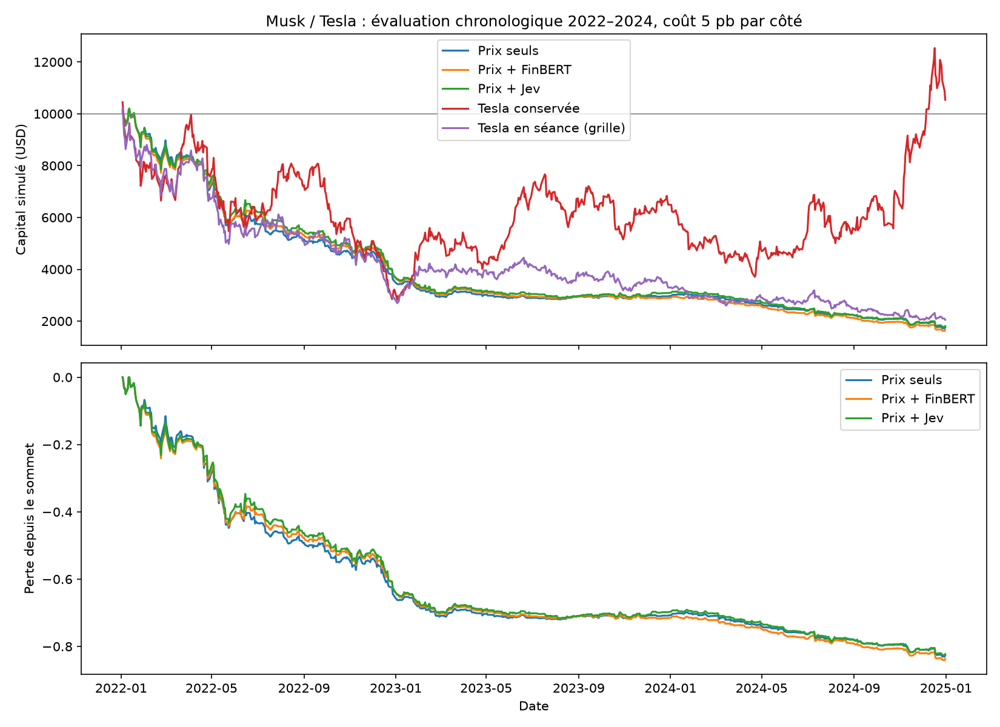

# Premier backtest Musk / Tesla — 25 octobre 2026

**Résultat : aucune des variantes simples testées ne gagne d’argent sur 2022–2024.** Ajouter les scores de Jev améliore légèrement le résultat global par rapport aux seuls prix, mais l’écart est incertain et varie selon les années. FinBERT dégrade le résultat global. Les achats et ventes fréquents rendent ces stratégies particulièrement sensibles aux frais.

Trump reste dans le périmètre du camarade : aucun jeu de données ni résultat Trump n’a été trouvé localement et aucun n’a été ajouté pour cette expérience.

**Résultats antérieurs**

Le notebook 02 portait sur 2 894 posts Musk/Tesla, avec 546 événements utilisables pour les quatre horizons. FinBERT et Jev s’accordaient sur le sentiment dans 54,6 % des cas. Le score Jev `impact` présentait une corrélation de 0,1275 avec la réaction relative TSLA–QQQ à l’horizon étiqueté +1 minute, mais cette fenêtre commençait avant le post. C’était une association avec la réaction du marché, pas un résultat de portefeuille. Le présent backtest utilise des prix d’entrée postérieurs aux informations disponibles.

**Protocole fixé avant le premier lancement**

- Apprentissage initial : 2018–2021. Évaluation sur 2022, puis réentraînement sur 2018–2022 pour évaluer 2023, puis sur 2018–2023 pour évaluer 2024. Chaque cible d’apprentissage est entièrement réalisée avant l’année évaluée.
- 18 000 intervalles évalués sur 753 jours de bourse. Décisions toutes les 15 minutes, de 9 h 45 à 15 h 30 à New York, sorties 15 minutes plus tard. Les séances écourtées suivent le calendrier local.
- Les horaires sont fixes et indépendants des tweets : la référence « prix seuls » n’utilise donc ni leur présence, ni leur heure, ni leur texte.
- À l’entrée t, les tweets admissibles ont été publiés au plus tard à t−60 secondes. Les derniers prix utilisables sont ceux de la barre commençant à t−2 minutes, terminée à t−1 minute. Cette marge laisse une minute pour recevoir et traiter les informations. Le prix d’entrée est l’ouverture de la barre t ; le prix de sortie est l’ouverture à t+15 minutes.
- Modèle identique pour chaque variante : régression logistique, régularisation C=1, seuil de hausse 0,5, sans recherche d’hyperparamètres. Imputation des valeurs manquantes et normalisation ajustées uniquement sur l’apprentissage de chaque année.
- Prix : rendements passés TSLA et QQQ à 1, 5, 15 et 60 minutes, volatilité récente et heure de la séance. Les prix historiques à 60 minutes peuvent être ceux d’avant l’ouverture ; tous précèdent la décision.
- Social : nombre de posts sur les 15/60 minutes précédant la date de disponibilité, puis moyenne et dernier score des posts sur la fenêtre de 60 minutes. Variante FinBERT : sentiment ; variante Jev : sentiment, impact attendu et pertinence. Tous les scores proviennent des caches existants. Aucun nouvel appel API.
- Portefeuille : 10 000 USD initiaux, investi intégralement dans Tesla lorsque le signal annonce une hausse ; sinon liquidités. Fractions d’action permises, sans levier ni vente à découvert. Les positions contiguës sont conservées, sans payer artificiellement un aller-retour toutes les 15 minutes. Les actions sont vendues à chaque interruption de la grille et en fin de journée ; pas de position de nuit.
- Frais globaux hypothétiques de 0, 2, 5 ou 10 points de base par côté, couvrant commissions, spread et glissement. **5 points de base = 0,05 % à l’achat et à la vente**, environ 10 USD pour un aller-retour sur 10 000 USD. Ce ne sont pas des coûts mesurés dans un carnet d’ordres historique.
- Aucun changement de seuil, de modèle ou d’horizon principal après constat des pertes.

**Comparaison principale, du 3 janvier 2022 au 31 décembre 2024**

| Stratégie | Rendement sans frais | Capital final avec 5 pb/côté | Rendement avec frais | Allers-retours avec frais |
|---|---:|---:|---:|---:|
| Liquidités, sans intérêts | 0,00 % | 10 000 USD | 0,00 % | 0 |
| Prix seuls | −21,10 % | 1 755 USD | −82,45 % | 1 503 |
| Prix + nombre de posts, sans sentiment | −28,46 % | 1 560 USD | −84,40 % | 1 523 |
| Prix + FinBERT | −24,28 % | 1 656 USD | −83,44 % | 1 520 |
| Prix + Jev | −18,54 % | 1 810 USD | −81,90 % | 1 504 |
| Tesla achetée sur tous les intervalles de la grille | −56,43 % | 2 052 USD | −79,48 % | 753 |
| Tesla achetée au début et conservée, nuits comprises | +5,50 % | 10 540 USD | +5,40 % | 1 |

La comparaison qui isole l’ajout des données sociales est « prix seuls » contre les variantes enrichies : mêmes périodes, horaires, classe de modèle et règles de portefeuille. La ligne « nombre de posts » aide à distinguer l’activité de publication et le contenu des scores.

Le placement passif conserve Tesla pendant les nuits et toutes les heures de marché, contrairement aux stratégies intraday. La référence « tous les intervalles de la grille » montre que cette différence d’exposition compte beaucoup sur la période. Les résultats ne permettent pas d’attribuer toute la sous-performance des modèles à la qualité de leurs prévisions.

Avec le coût central, les modèles sont investis pendant environ 14–15 % des intervalles mais effectuent environ 1 500 allers-retours. À cette fréquence, un coût de 0,10 % par aller-retour peut consommer une part très importante du capital par composition. Les pertes existent néanmoins déjà sans frais.

**Sensibilité aux coûts, rendement cumulé 2022–2024**

| Stratégie | 0 pb/côté | 2 pb/côté | 5 pb/côté | 10 pb/côté |
|---|---:|---:|---:|---:|
| Prix seuls | −21,10 % | −56,75 % | −82,45 % | −96,10 % |
| Prix + FinBERT | −24,28 % | −58,78 % | −83,44 % | −96,38 % |
| Prix + Jev | −18,54 % | −55,36 % | −81,90 % | −95,98 % |

Le niveau central est donc une hypothèse de scénario, pas une condition nécessaire au constat négatif : les trois modèles perdent aussi sans frais.

**Stabilité selon l’année, avec 5 pb/côté**

| Année | Prix seuls | Prix + FinBERT | Prix + Jev |
|---|---:|---:|---:|
| 2022 | −64,61 % | −62,96 % | −62,68 % |
| 2023 | −16,30 % | −21,92 % | −17,30 % |
| 2024 | −40,74 % | −42,74 % | −41,34 % |

Jev améliore 2022 mais dégrade légèrement 2023 et 2024 par rapport aux prix seuls. L’amélioration cumulée est de **0,55 point de rendement**, soit environ **55 USD** de capital final. Sur les 18 000 décisions, un tweet classé est présent dans la fenêtre sociale de 745 intervalles, soit 4,14 %. Cette expérience porte donc sur un signal social rare et des horizons intraday précis, pas sur tout effet possible des publications de Musk.

L’incertitude a été estimée en rééchantillonnant des mois entiers, en conservant ensemble les résultats des variantes comparées : 3 000 tirages sur 36 mois. La différence annualisée des rendements logarithmiques est estimée à +1,04 point pour Jev, avec un intervalle à 95 % de **−4,42 à +7,21 points** ; pour FinBERT, −1,95 point, intervalle **−7,76 à +3,94 points**. Les deux intervalles incluent zéro. Cette mesure statistique diffère de l’écart de rendement cumulé du tableau ; elle ne fournit pas de preuve d’un avantage social régulier.

La précision de direction se situe entre environ 48,5 % et 50,7 % selon l’année et la variante. Cela reste proche du hasard et ne suffit pas à financer les transactions. Le seuil 0,5 cherche une direction probable, pas un gain attendu supérieur aux coûts : c’est une limite de cette première stratégie volontairement simple.

**Contrôle complémentaire : acheter uniquement après un post Jev « up »**

Cette règle descriptive n’apprend aucun modèle : achat après un post classé haussier, attente minimale de 60 secondes puis arrondi à la minute suivante, sortie après la durée indiquée. Les messages publiés hors séance ne déclenchent pas de transaction ; les posts concurrents pendant une position sont ignorés. L’exécution reste simulée aux prix d’ouverture des barres.

| Durée de détention | Événements retenus | Rendement sans frais | Rendement avec 5 pb/côté | Capital final avec frais |
|---|---:|---:|---:|---:|
| 1 minute | 93 | −0,32 % | −9,18 % | 9 082 USD |
| 5 minutes | 89 | +2,88 % | −5,78 % | 9 422 USD |
| 15 minutes | 85 | +1,27 % | −6,98 % | 9 302 USD |
| 60 minutes | 71 | −5,77 % | −12,23 % | 8 777 USD |

Ces horizons sont des sensibilités exploratoires, pas quatre tests indépendants sélectionnant un gagnant. À cinq minutes, le petit gain brut disparaît déjà dans le scénario de 2 pb par côté : −0,67 %. Aucun de ces résultats ne démontre une rentabilité nette.

**Ce que l’on peut conclure et ce qui reste ouvert**

Le backtest ne valide pas les stratégies simples essayées. Sur ce protocole, Jev ajoute au mieux un petit écart favorable global, avec une incertitude large, et FinBERT ne fait pas mieux que les prix seuls. Cela justifie de travailler sur la sélection des événements, la cible économique et la fréquence des transactions avant d’essayer des modèles plus volumineux.

Il reste des limites importantes : les classifieurs de texte peuvent avoir été entraînés après certains événements ; 2018–2024 avait déjà été exploré avant ce backtest ; l’évaluation chronologique n’est donc pas un test final vierge. Les prix des barres sont des transactions historiques, pas des cotations bid/ask ou des prix d’exécution garantis. Les barres historiques peuvent aussi intégrer des corrections ultérieures. Les publications antérieures de plus d’une heure à la date limite de disponibilité n’entrent pas dans les variables sociales, notamment beaucoup de posts de nuit.

La grille comporte 42 084 intervalles planifiés sur 2018–2024, dont 63 sans prix d’entrée ou sortie exact, exclus sans propagation de cours ; ces exclusions se situent dans l’apprentissage, les 18 000 intervalles de 2022–2024 disposent de leurs prix. Les autres valeurs de variables manquantes sont imputées sur les données d’apprentissage uniquement. Les news Benzinga et résultats trimestriels ne sont pas utilisés dans cette première comparaison.

Les métriques complètes incluent la pire perte depuis un sommet (« drawdown ») et le rendement rapporté au risque (« Sharpe »). Le drawdown est mesuré aux limites de la grille pour les stratégies et aux clôtures quotidiennes pour le placement passif ; il peut sous-estimer les pertes temporaires entre deux points. Les intérêts des liquidités, la fiscalité et l’impact de marché ne sont pas modélisés. La comptabilité est en USD : interpréter le capital en euros supposerait un taux EUR/USD constant, qui n’a pas été testé.

**Fichiers et reproduction**

- Moteur : `src/backtest.py`.
- Lancement : `venv/bin/python reports/run_musk_backtest.py`.
- Vérifications : `venv/bin/python -m unittest discover -s tests -v`.
- Résultats complets : `reports/backtest_musk_2026-10-25/`, notamment `metrics.csv`, `annual_metrics.csv`, `event_metrics.csv`, `folds.csv`, `predictions.parquet`, `daily_returns.csv` et `metadata.json`.
- Les métadonnées enregistrent les hypothèses, les versions des bibliothèques et les empreintes SHA-256 des six fichiers d’entrée. Les tests vérifient notamment les frais, la conservation entre intervalles, la liquidation lors d’un trou, le refus de positions superposées et l’absence d’utilisation de prix ou posts trop récents.

La convention d’horodatage des barres et leurs corrections possibles sont documentées par [Alpaca sur les barres à la minute](https://alpaca.markets/learn/stock-minute-bars) et [les mises à jour de barres](https://docs.alpaca.markets/us/docs/real-time-stock-pricing-data).
