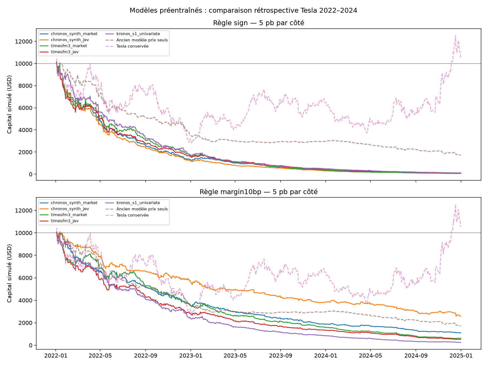

# Essais des modèles préentraînés sur Musk / Tesla — 25 octobre 2026

**Aucune des configurations complètes testées n'est rentable après le coût central, y compris avec la règle d'abstention.** Les bonnes directions sur le benchmark complet vont de **48.42 % à 50.31 %**. Le score KiT de 24/36 appartient à un pilote distinct et ne constitue pas une validation hors préentraînement.

Les modèles ont été téléchargés, chargés et exécutés sur les données locales. TimesFM-3, Chronos-2-Synth, Chronos-2 et Kronos-small ont chacun des prévisions couvrant les **18 000 décisions de 2022–2024**. KiT a été exécuté sur **36 origines mensuelles distinctes**, dans un pilote séparé. Le détail chiffré ci-dessous permet de distinguer la qualité de prévision et la conséquence d'une règle de trading.

**Calcul effectivement réalisé sur AMD**

GPU détecté : **AMD Radeon RX 6750 XT**, 12 Go. Environnement isolé `.venv-forecast/`, **PyTorch 2.6.0+rocm6.2.4**, ROCm/HIP **6.2.41134-65d174c3e**, variable `HSA_OVERRIDE_GFX_VERSION=10.3.0`. Les modèles utilisent le périphérique PyTorch `cuda`, qui désigne ici le GPU AMD via ROCm. L'environnement initial `venv/` conserve son PyTorch CPU.

Le GPU a été observé à près de 100 % d'utilisation pendant les calculs. La variante KiT FP16 a produit des trajectoires finies et positives sur les cas évalués ; TimesFM, Chronos et le benchmark principal Kronos utilisent FP32. Un essai de vitesse Kronos en autocast FP16 n'a pas justifié de remplacer le calcul FP32 engagé. Ces essais numériques ne constituent pas une preuve de calibration financière.

**Protocole et limites de comparaison**

- Dates, exécutions et coûts repris du premier backtest : 753 séances, décisions toutes les 15 minutes, entrée après les informations disponibles, sorties 15 minutes plus tard, achat Tesla ou liquidités, sans levier ni vente à découvert, fractions d'action autorisées, pas de position de nuit.
- Dernier chandelier observé : celui qui commence à t−2 minutes et finit à t−1. Les tweets utilisés sont donc antérieurs d'au moins 60 secondes à l'entrée. Les prix d'exécution restent les ouvertures réelles à t et t+15.
- Prévisions de 17 ouvertures successives : première ouverture prévue à t−1, deuxième à t, dix-septième à t+15. Le signal compare les indices 1 et 16 de la trajectoire prévue. Le vrai cours d'entrée n'est pas utilisé pour construire le signal ; la réaction antérieure à l'entrée est exclue.
- Entrées TimesFM/Chronos : 128 barres de séance consécutives, pouvant traverser une nuit entre deux séances sans fabriquer de barres nocturnes. La cible est la série des ouvertures TSLA ; la variante marché ajoute les ouvertures QQQ historiques. Ces variantes ne reçoivent pas tous les champs OHLCV, contrairement à Kronos, qui utilise sa représentation native. Ce choix d'entrée est une limite du test de leur potentiel maximal.
- Les fenêtres contiennent les barres régulières ; les rares minutes historiques sans transaction sont représentées au dernier cours passé avec volume nul. Aucun prix d'exécution n'est ainsi fabriqué. Les 18 000 points d'entrée et sortie du test disposent de leurs prix réels.
- Les variables sociales sont uniquement historiques : nombre de posts dans les 60 minutes précédentes, sentiment FinBERT ou sentiment/impact/pertinence Jev. Aucun futur tweet ni futur prix QQQ n'est fourni. Le contrôle `zero_jev` garde le même nombre de canaux que Jev mais remplace les canaux sociaux par zéro.
- Poids préentraînés figés : aucun réentraînement annuel de ces modèles. La comparaison utilise les mêmes années évaluées que la régression logistique, mais les modes d'apprentissage et les représentations diffèrent. Le modèle Synth est annoncé comme entraîné uniquement sur des séries synthétiques ; les scores textuels eux-mêmes restent rétrospectifs.
- Kronos : une trajectoire par origine (valeur par défaut du dépôt), température 1 et top-p 0,9, graine 20261025 + début du lot. La variabilité entre graines n'est pas évaluée ; ce budget de tirage est une limite du test. Un premier calcul de trois trajectoires, plus coûteux, a été arrêté avant d'examiner ses résultats et n'entre pas dans les comparaisons finales. KiT : fenêtre native de 1200 barres, horizon natif de 120 barres, 8 trajectoires et 16 étapes Euler ; seules les prévisions nécessaires aux 15 minutes sont évaluées. Les budgets de calcul ne sont donc pas identiques.
- Deux règles publiées : achat si le rendement prévu est positif (`sign`), et achat seulement au-dessus de 0,10 % (`margin10bp`). La seconde marge correspond approximativement aux coûts centraux aller-retour ; elle n'a pas été optimisée sur ces résultats. Les scénarios de coût gardent les mêmes positions pour chaque règle.

**Résultats du benchmark complet**

Capital initial : 10 000 **USD**, sans simulation de conversion EUR/USD. Coût central : 5 points de base par côté, soit 0,05 % à l'achat et 0,05 % à la vente, couvrant hypothétiquement commissions, spread et glissement. Les prévisions ne sont pas des prix d'exécution garantis.

| Variante | Bonne direction | Rendement brut, signe | Rendement net, signe | Capital net, signe | Rendement net, marge 0,10 % |
| --- | --- | --- | --- | --- | --- |
| Chronos-2-Synth : TSLA seul | 49.66 % | -67.67 % | -98.94 % | 106 USD | -90.17 % |
| Chronos-2-Synth : TSLA + QQQ | 49.59 % | -71.04 % | -99.05 % | 95 USD | -88.99 % |
| Chronos-2-Synth + FinBERT | 49.04 % | -74.09 % | -99.13 % | 87 USD | -78.54 % |
| Chronos-2-Synth + Jev | 48.82 % | -76.42 % | -99.26 % | 74 USD | -74.12 % |
| TimesFM-3 : TSLA seul | 49.60 % | -73.26 % | -99.28 % | 72 USD | -95.19 % |
| TimesFM-3 : TSLA + QQQ | 49.15 % | -80.51 % | -99.36 % | 64 USD | -93.86 % |
| TimesFM-3 + FinBERT | 49.45 % | -76.98 % | -99.08 % | 92 USD | -93.56 % |
| TimesFM-3 + Jev | 49.52 % | -75.45 % | -98.90 % | 110 USD | -94.78 % |
| Chronos-2 : TSLA seul | 48.42 % | -77.82 % | -99.53 % | 47 USD | -94.94 % |
| Chronos-2 : TSLA + QQQ | 48.88 % | -77.12 % | -99.45 % | 55 USD | -93.86 % |
| Chronos-2 + Jev | 49.47 % | -41.21 % | -98.11 % | 189 USD | -76.74 % |
| Kronos-small : OHLCV | 50.31 % | -40.75 % | -99.02 % | 98 USD | -97.49 % |

Références sur ces mêmes dates : ancien modèle prix seuls **49.47 %** de bonnes directions, −21,10 % sans frais et −82,45 % avec le coût central ; acheter systématiquement sur chaque intervalle correspond à une direction haussière correcte **50.46 %** du temps. Conserver Tesla depuis le début, nuits comprises, donne +5,40 % net, avec une exposition différente de celle des modèles intraday. Les liquidités sans intérêts restent à 10 000 USD.

L'erreur absolue moyenne d'une prévision de rendement nul est de **0.366 %** par intervalle. Les erreurs, corrélations, résultats annuels, pertes maximales et nombres d'allers-retours de tous les modèles sont dans les CSV associés. Une bonne précision du niveau de prix ne suffirait pas à établir une bonne prévision de rendement.

**Attribuer correctement l'effet social**

Un post classé figure dans la fenêtre sociale de **745 / 18 000 intervalles**, soit 4.14 %. L'ajout de canaux peut modifier les prévisions même quand ces canaux sont constants. Une amélioration avec un score social peut aussi venir d'une plus faible amplitude prévue, entraînant moins de transactions. Le contrôle nul permet de ne pas attribuer automatiquement cet effet au contenu des tweets.

| Variante | Bonne direction | Rendement net, règle avec marge | Allers-retours |
| --- | --- | --- | --- |
| Chronos-2-Synth : TSLA + QQQ | 49.59 % | -88.99 % | 1496 |
| Chronos-2-Synth : contrôle social nul | 48.85 % | -71.96 % | 967 |
| Chronos-2-Synth + Jev | 48.82 % | -74.12 % | 993 |
| TimesFM-3 : TSLA + QQQ | 49.15 % | -93.86 % | 2003 |
| TimesFM-3 : contrôle social nul | 49.47 % | -94.84 % | 1867 |
| TimesFM-3 + Jev | 49.52 % | -94.78 % | 1881 |

Pour les différences de portefeuille, des mois entiers sont rééchantillonnés ensemble entre variantes (3 000 tirages sur 36 mois). La statistique ci-dessous est une différence annualisée de rendements **logarithmiques**, exprimée en points ; elle n'est pas l'écart de rendement cumulé de la première table. Les intervalles sont exploratoires, sans correction globale pour toutes les variantes et tous les critères testés.

| Famille | Score ajouté | Contrôle | Différence annualisée | Intervalle 95 % |
| --- | --- | --- | --- | --- |
| timesfm3 | finbert | market | +1.57 points | [-10.98 ; +14.64] |
| timesfm3 | jev | market | -5.45 points | [-17.40 ; +6.65] |
| timesfm3 | jev | zero_jev | +0.36 points | [-3.89 ; +4.66] |
| chronos_synth | finbert | market | +22.32 points | [+6.45 ; +38.73] |
| chronos_synth | jev | market | +28.59 points | [+10.75 ; +44.94] |
| chronos_synth | jev | zero_jev | -2.68 points | [-6.52 ; +0.73] |
| chronos2 | jev | market | +44.56 points | [+27.71 ; +62.01] |

**KiT : pilote séparé, avec chevauchement du préentraînement**

Origines fixées avant l'examen des résultats : première séance de chaque mois à midi, heure de New York, sur 2022–2024. KiT produit des prévisions pour les 36 dates ; la table compare les autres modèles sur **ces mêmes dates**, pas sur leurs 18 000 décisions.

| Modèle | Origines | Bonne direction | Erreur absolue moyenne de rendement |
| --- | --- | --- | --- |
| KiT (pilote) | 36 | 66.67 % | 0.254 % |
| Kronos-small : OHLCV | 36 | 55.56 % | 0.481 % |
| TimesFM-3 : TSLA + QQQ | 36 | 36.11 % | 0.450 % |
| Chronos-2-Synth : TSLA + QQQ | 36 | 52.78 % | 0.366 % |
| Chronos-2 : TSLA + QQQ | 36 | 38.89 % | 0.427 % |
| Direction toujours haussière | 36 | 58.33 % | — |

KiT : 24 bonnes directions sur 36 ; intervalle binomial à 95 % approximatif [49.0 % ; 81.4 %], à lire avec prudence sur un échantillon aussi petit et rétrospectif. Aucun portefeuille KiT de trois ans n'est assimilé à celui des modèles complets.

Le checkpoint global téléchargé déclare une borne d'apprentissage au **2025-12-31**, et son vocabulaire contient explicitement TSLA (identifiant 4884). Les données 2022–2024 ne constituent donc pas une période démontrée hors préentraînement pour KiT. Son pilote vérifie le fonctionnement et décrit ses prévisions sur nos données ; il ne démontre pas une capacité à prévoir des événements inconnus. La même vérification de provenance reste nécessaire pour les autres modèles, notamment les classifieurs de texte. Le checkpoint KiT plus récent daté de 2026 et limité aux actions chinoises n'a pas été utilisé pour Tesla.

**Coût de calcul observé**

| Variante complète | Temps d'inférence cumulé observé |
| --- | --- |
| Chronos-2-Synth : TSLA seul | 37.1 s |
| Chronos-2-Synth : TSLA + QQQ | 40.3 s |
| Chronos-2-Synth + FinBERT | 69.3 s |
| Chronos-2-Synth + Jev | 241.1 s |
| TimesFM-3 : TSLA seul | 55.4 s |
| TimesFM-3 : TSLA + QQQ | 78.7 s |
| TimesFM-3 + FinBERT | 114.0 s |
| TimesFM-3 + Jev | 521.0 s |
| Chronos-2 : TSLA seul | 229.2 s |
| Chronos-2 : TSLA + QQQ | 241.5 s |
| Chronos-2 + Jev | 300.1 s |
| Kronos-small : OHLCV | 761.6 s |

Pilote KiT : 1727.5 secondes cumulées pour les 36 origines. Ces mesures incluent l'attente liée aux autres expériences partageant le GPU ; elles ne forment pas un classement de vitesse isolé. Téléchargement et chargement sont exclus des temps d'inférence. Les calculs par lots sont adaptés à l'évaluation historique ; ils ne mesurent pas la latence complète de détection et d'exécution d'un ordre en direct.

**Lecture scientifique des résultats**

Les valeurs du tableau décrivent des modèles, entrées, horizons et règles précis. Il faut apprécier ensemble la précision, le rendement brut, les frais et l'exposition. Un taux proche de 50 % peut parfois correspondre à un signal économiquement utile si les gains et pertes sont asymétriques ; il ne suffit pas à lui seul pour valider ou invalider une stratégie. À l'inverse, une différence de capital après des milliers de transactions ne prouve pas que le modèle comprend mieux les tweets.

Cette comparaison est rétrospective : la période avait déjà été explorée avant les essais, et certains corpus de préentraînement peuvent recouvrir ces années. Les règles n'ont pas été sélectionnées pour maximiser un gain après inspection des résultats. Les variantes défavorables et les contrôles restent publiés. Les frais sont hypothétiques, les intérêts des liquidités, la fiscalité, la liquidité réelle et l'impact de marché ne sont pas modélisés. Les pertes maximales sont calculées aux points de valorisation, sans toutes les fluctuations internes à un intervalle.

**Reproduction et livrables**

- À partir du venv initial installé, `bash reports/setup_forecast_environment.sh` recrée la surcouche ROCm et télécharge les révisions exactes des poids et sources. Les données locales du projet restent nécessaires.
- Prévisions complètes : `HSA_OVERRIDE_GFX_VERSION=10.3.0 .venv-forecast/bin/python reports/run_foundation_benchmark.py --family timesfm3 --batch-size 32` ; même commande avec `chronos_synth`, puis `chronos2 --variants univariate market jev`, et `kronos --variants univariate`.
- Contrôles : familles `timesfm3` et `chronos_synth`, option `--variants zero_jev`.
- KiT : `HSA_OVERRIDE_GFX_VERSION=10.3.0 .venv-forecast/bin/python reports/run_kit_pilot.py --paths 8 --steps 16 --precision fp16`.
- Évaluation : `HSA_OVERRIDE_GFX_VERSION=10.3.0 .venv-forecast/bin/python reports/score_foundation_benchmark.py`, puis `... reports/write_foundation_report.py`.
- Tests : `.venv-forecast/bin/python -m unittest discover -s tests -v`.
- Versions des bibliothèques, empreintes des sources et des données de référence, révisions des poids et des dépôts : `foundation_benchmark_2026-10-25/metadata.json` et `environment.json`. Les poids et sources tierces sont conservés dans le cache Hugging Face et `data/vendor/`, exclus de Git.
- Les prédictions par lots sont persistées pour reprendre un calcul interrompu ; ne pas réutiliser ces caches après modification du protocole sans les régénérer.
- Résultats : `forecast_metrics.csv`, `metrics.csv`, `annual_returns.csv`, `social_uncertainty.csv`, `pilot_matched_comparison.csv`, `kit_pilot.csv`, `forecast_returns.parquet`, `daily_returns.csv`, courbes de capital et journaux.

Sources des modèles : [Google TimesFM](https://github.com/google-research/timesfm), [Chronos](https://github.com/amazon-science/chronos-forecasting), [Kronos](https://github.com/shiyu-coder/Kronos), [KiT](https://github.com/Luciferbobo/KiT). Les résultats locaux de ce rapport proviennent des fichiers produits par les scripts, et non des performances annoncées par leurs auteurs.
